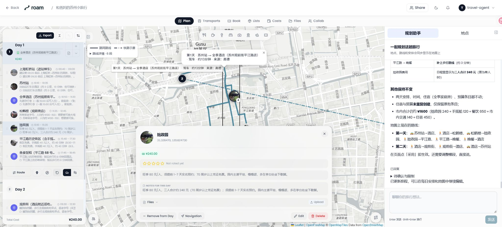
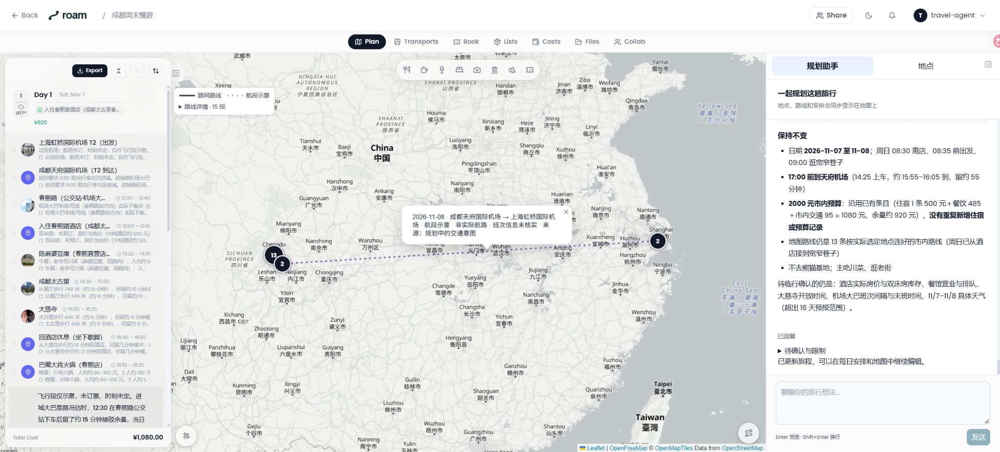

# Roam Planner

把旅行想法聊成可以看、可以改、可以采用的行程。

Roam Planner 是一套可自行部署的旅行规划助手：通过多轮对话确认偏好与限制，把地点、时间、交通和费用放到同一张行程地图上。



图中为演示行程；未订的交通与住宿保留待确认状态。

- **边聊边确认**：先说目的地和想法，再补日期、同行者、预算、步行能力与偏好；支持规划中补充要求。
- **路线有依据**：可获得的高德道路轨迹沿路显示；铁路与航段各用不同示意线，明确区分班次核实情况。
- **先看方案，再采用**：草稿可定位和编辑；采用后继续修改会关联现有日程，保留已有预算与住宿。
- **会话可继续**：刷新页面、关闭浏览器后可回到原旅程；停止规划后可继续对话。
- **旅行资料集中管理**：日程、地点、住宿、费用、清单与文件沿用 TREK 的旅行管理能力。



## 快速开始

需要 Git、Docker 和 Docker Compose。首次启动会从源码构建三个服务。

```sh
git clone https://github.com/AntonyLang/roam-planner.git
cd roam-planner
cp product.env.example .env.product
```

编辑 `.env.product`，填写 `DEEPSEEK_API_KEY`；使用中国地点搜索和路网时再填写高德 **Web 服务 Key** `AMAP_API_KEY`。模型和服务地址也在这个文件配置。

```sh
docker compose --env-file .env.product up --build -d --wait
```

打开 [http://localhost:3000](http://localhost:3000)，新建一次旅行，在行程页右侧与规划助手交流。当前部署采用本地单用户模式，默认端口仅绑定本机。

可以先试一句：**“想带爸妈去苏州玩两天，轻松一点，你先帮我看看。”** 后续再回答助手对日期、预算和步行能力的询问。

## 文档

[配置模型与高德](docs/configuration.md) · [部署、数据与更新](docs/deployment.md) · [规划与地图使用](docs/usage.md) · [架构与服务职责](docs/architecture.md) · [常见问题](docs/troubleshooting.md)

## 来源与许可证

本项目由 AntonyLang 基于 [TREK 4.3.3](https://github.com/liketrek/TREK/tree/1c05ee4b3ac9523c41ccdd3baad989ba48a7409a) 演进，使用独立的 Roam 名称和标识，沿用 [AGPL-3.0](LICENSE)。源码归属及第三方数据说明见 [NOTICE.md](NOTICE.md)；上游标识政策见 [TRADEMARKS.md](TRADEMARKS.md)。Agent 运行时采用 [Pi Durable](https://github.com/earendil-works/pi)。
