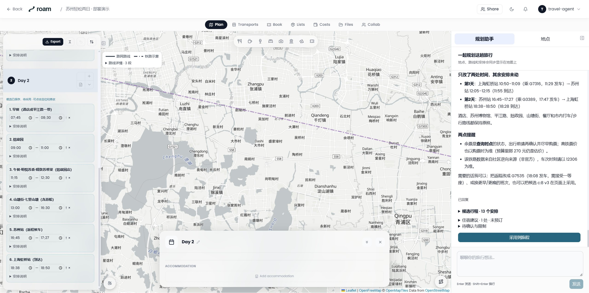
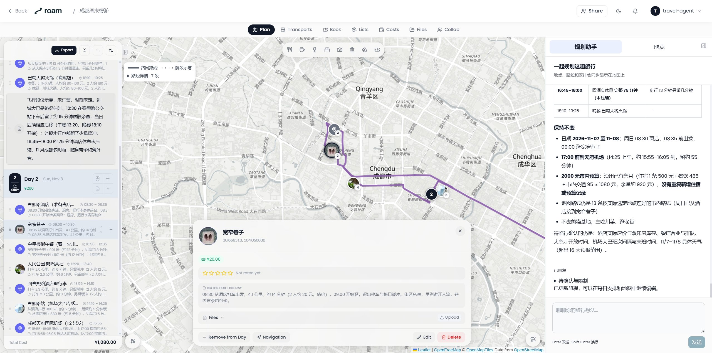
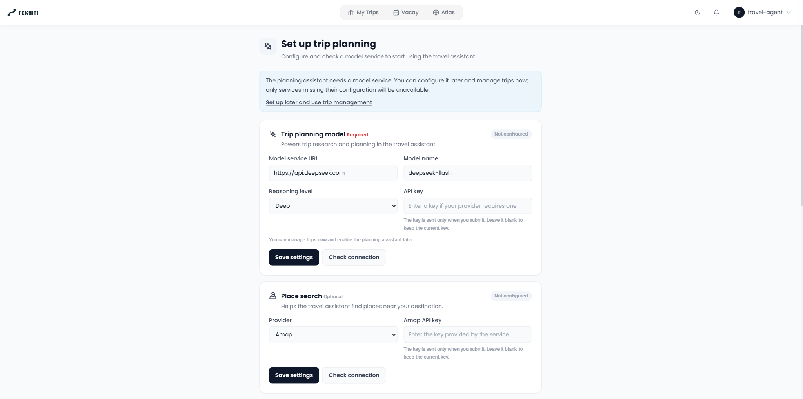

# Roam Planner

把旅行想法聊成可以看、可以改、可以采用的行程。

Roam Planner 是一套可自行部署的旅行规划助手：通过多轮对话确认偏好与限制，把地点、时间、交通和费用放到同一张行程地图上。

## 使用版本

| 版本 | 适用方式 | 入口 |
|---|---|---|
| 独立部署版（本仓库） | 通过 Docker 运行旅行工作台，管理日程、预算、预订、文件与协作 | [快速开始](#快速开始) |
| DSH 插件版 | 已有 DeepSeek Harness 环境，在宿主对话中规划旅行，并联动日程与地图 | [插件仓库](https://github.com/AntonyLang/dsh-roam-planner) · [npm](https://www.npmjs.com/package/dsh-roam-planner) |

DSH 插件版为独立重写，聚焦对话规划、日程地图、草稿修订与采用；原工作台的预算、预订、文件与协作页面暂未覆盖。安装与宿主要求见[插件说明](https://github.com/AntonyLang/dsh-roam-planner#readme)，安装后需重启 DSH；铁路和小红书通过可选 MCP 服务接入。

[阅读迁移过程与取舍](https://lingulang.com/articles/roam-planner-to-dsh-plugin)

## 产品篇

60 秒看懂对话规划、地图与日程联动，以及多轮修改。1920 × 1080 · 30fps，配乐与音效，静音也能看懂。

https://github.com/user-attachments/assets/fe9960e9-6c1e-42de-8961-ab0c81397d4b

[▶ 单独播放产品篇](https://github.com/user-attachments/assets/fe9960e9-6c1e-42de-8961-ab0c81397d4b) · [下载 MP4](https://github.com/AntonyLang/roam-planner/raw/refs/heads/main/docs/media/roam-product-landscape.mp4)

## 产品能力



图中为演示行程；未订的交通与住宿保留待确认状态。

- **边聊边确认**：先说目的地和想法，再补日期、同行者、预算、步行能力与偏好；支持规划中补充要求。
- **路线有依据**：地图点直接标注行程序号，高德道路轨迹沿路显示；内含铁路 MCP 查询服务，铁路与航段各用不同示意线，明确区分班次核实情况。
- **地图与日程联动**：切换日期只看当天地点；点选左侧地点，地图居中并打开详情。
- **先看方案，再采用**：草稿可定位和编辑；采用后继续修改会关联现有日程，保留已有预算与住宿。
- **会话可继续**：刷新页面、关闭浏览器后可回到原旅程；停止规划后可继续对话。
- **在页面完成配置**：首次进入自动引导，支持模型与地图 Key、连接检查和小红书扫码登录；之后可从首页进入服务配置。
- **旅行资料集中管理**：日程、地点、住宿、费用、清单与文件沿用 TREK 的旅行管理能力。



## 面试技术片

2 分 30 秒讲解 RAG 检索研究、主子 Agent 协作、持久会话、MCP 联动与评测迭代。1920 × 1080 · 30fps，中文旁白、字幕与动态架构图；片中区分产品默认能力与研发实验。

https://github.com/user-attachments/assets/a80b11f5-d4de-48e0-b15b-29f11917f1b0

[▶ 单独播放面试技术片](https://github.com/user-attachments/assets/a80b11f5-d4de-48e0-b15b-29f11917f1b0) · [下载 MP4](https://github.com/AntonyLang/roam-planner/raw/refs/heads/main/docs/media/roam-technical-architecture.mp4)

## 快速开始

选择下面一种方式即可。两种方式都通过 Docker Compose 启动网页与旅程后端、规划 Agent、外部来源和铁路 MCP 四个服务，无需在电脑安装 Node.js、Python 或浏览器依赖。

### 方式一：Docker Hub 预构建镜像（推荐）

适合直接使用。只需 Docker Engine / Docker Desktop 和 Docker Compose，不需要 Git，也不需要下载完整源码。当前镜像版本为 `0.2.2`，发布平台为 Linux/amd64；Windows 使用 Docker Desktop 的 Linux 容器。

新建一个部署目录，将 [compose.yaml](https://raw.githubusercontent.com/AntonyLang/roam-planner/main/compose.yaml) 下载到里面。

Windows PowerShell：

```powershell
mkdir roam-planner
cd roam-planner
Invoke-WebRequest -Uri https://raw.githubusercontent.com/AntonyLang/roam-planner/main/compose.yaml -OutFile compose.yaml
```

Linux / macOS 终端：

```sh
mkdir roam-planner
cd roam-planner
curl -fL https://raw.githubusercontent.com/AntonyLang/roam-planner/main/compose.yaml -o compose.yaml
```

在这个目录拉取镜像并启动：

```sh
docker compose pull
docker compose up -d --wait --no-build
docker compose ps
```

[`pull`](https://docs.docker.com/reference/cli/docker/compose/pull/) 下载 Compose 指定的镜像，[`up`](https://docs.docker.com/reference/cli/docker/compose/up/) 启动容器并等待就绪；`--no-build` 明确使用镜像，不在本机编译源码。首次启动无需创建 Key 文件。

镜像：[网页与旅程](https://hub.docker.com/r/antonyaty/roam-planner) · [规划 Agent](https://hub.docker.com/r/antonyaty/roam-planner-agent) · [外部来源](https://hub.docker.com/r/antonyaty/roam-planner-sources)。铁路 MCP 随 Compose 启动，无需额外 Key。

### 方式二：拉取仓库，从源码构建

适合修改代码或自行构建镜像。需要 Git、Docker 和 Docker Compose：

```sh
git clone https://github.com/AntonyLang/roam-planner.git
cd roam-planner
docker compose build
docker compose up -d --wait --no-build
```

编译和依赖安装在镜像构建过程中完成。源码构建所需的网络访问与自定义部署说明见[部署文档](docs/deployment.md)。

### 首次打开与配置

1. 打开 [http://localhost:3000](http://localhost:3000)，进入首次服务引导。
2. 填写模型服务地址、模型名称与 API Key，保存并检查连接；按需填写高德 Web 服务 Key。也可点“稍后配置，先使用”管理旅程和查看地图，依赖缺失配置的服务会提示补齐。
3. 新建旅行，在行程页右侧与规划助手交流。日后可从首页或用户菜单进入“服务配置”修改。

两种方式都采用本地单用户模式，默认端口仅绑定本机。小红书是默认关闭的可选来源，不配置也能使用规划助手；平台可能限制部分容器网络，具体见[配置说明](docs/configuration.md#小红书)。



可以先试一句：**“想带爸妈去苏州玩两天，轻松一点，你先帮我看看。”** 后续再回答助手对日期、预算和步行能力的询问。

### 更新与停止

更新前等待当前规划结束并备份数据。Docker Hub 方式先下载新版 `compose.yaml`，再执行 `docker compose pull` 和启动命令；源码方式执行 `git pull --ff-only`、`docker compose build` 和启动命令。若使用本地版本或端口配置，更新时保持一致，详见[部署、数据与更新](docs/deployment.md)。

停止服务可运行 `docker compose stop`，恢复时重新执行启动命令。旅程、服务配置与会话保存在 Docker 数据卷中；不要使用 `docker compose down -v`，它会删除这些数据。

## 文档

[配置模型与高德](docs/configuration.md) · [部署、数据与更新](docs/deployment.md) · [规划与地图使用](docs/usage.md) · [架构与服务职责](docs/architecture.md) · [常见问题](docs/troubleshooting.md)

## 来源与许可证

本项目由 AntonyLang 基于 [TREK 4.3.3](https://github.com/liketrek/TREK/tree/1c05ee4b3ac9523c41ccdd3baad989ba48a7409a) 演进，使用独立的 Roam 名称和标识，沿用 [AGPL-3.0](LICENSE)。源码归属及第三方数据说明见 [NOTICE.md](NOTICE.md)；上游标识政策见 [TRADEMARKS.md](TRADEMARKS.md)。Agent 运行时采用 [Pi Durable](https://github.com/earendil-works/pi)。
