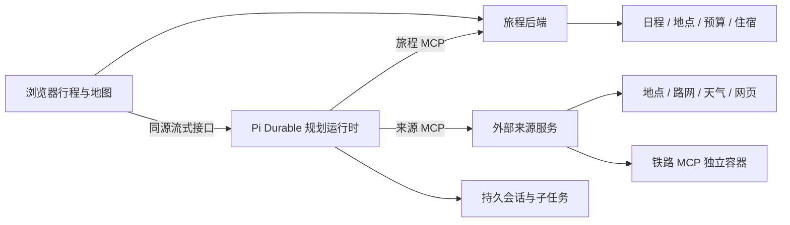

# 架构与职责

**旅程后端**拥有正式数据、版本、采用事务和实时同步。草稿写入不等同于正式采用。采用后续改通过实际采用回执找到已有日程，再生成替换范围，保留范围外内容。

**规划运行时**使用 Pi Durable 1.2.0，保存主会话、工具结果与子任务状态；可按需要委派子任务。核心草稿工具常驻，其余旅程工具按需发现。浏览器断开只关闭查看连接，停止任务须通过显式停止操作。

**外部来源 MCP**统一承接供应商差异、坐标系、来源、超时与可用性；正式写入由旅程 MCP 负责。高德道路几何与摘要分开传递：模型读取摘要，地图使用完整轨迹。铁路、航段意图独立于道路几何。

**前端**同时呈现草稿与正式行程，按当前相邻点、坐标、方向和交通方式匹配路线。修改地点或顺序后，不沿用已经失配的道路；铁路与航段始终保留示意语义。

**服务配置**由旅程后端加密持久化。浏览器只获得非敏感字段与密钥是否已配置；Agent 和 Sources 通过独立数据卷内的随机凭据读取各自所需字段。Agent 在提交下一次规划前更新模型目录和凭据，保留同一持久会话。Sources 短时缓存有效配置，拥有小红书 Chromium 登录流程与加密 session；旅程后端只代理状态摘要和二维码。

## 效率与费用

候选列表默认提供版本摘要，需要时显式回读完整方案；按需发现工具可减少一次请求暴露的工具定义。持久对话保留连续上下文，具体缓存命中由模型服务决定。

Token、缓存读取、输出和供应商报告费用是不同指标。长会话仍会累积工具结果；本地估算不包含所有供应商、代理或外部来源费用，不能直接作为账单。

当前 Docker 配置不依赖评测数据库或开发者工作台。静态指南属于可选的只读已发布库，未配置时关闭；不在产品运行时启动检索实验或题库管理。
